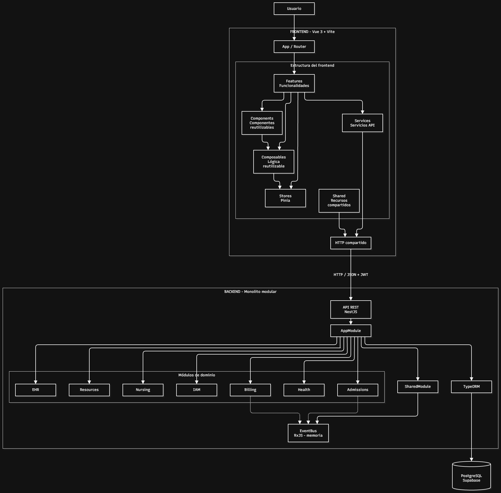

# Arquitectura del HIS

## Objetivo

Adaptar el monorepo existente a la arquitectura de referencia UTN sin cambiar Vue 3, Vite, NestJS, TypeORM ni PostgreSQL. La organización objetivo es un **monolito modular** con límites de dominio, capas hexagonales y eventos internos para reducir acoplamiento.

## Diagrama general de arquitectura

El sistema utiliza una arquitectura de monolito modular. El frontend está desarrollado con Vue 3 y Vite, y se comunica mediante HTTP/JSON con una API REST desarrollada en NestJS.

El backend organiza sus funcionalidades en módulos de dominio. La persistencia se realiza mediante TypeORM y PostgreSQL.



El archivo editable se encuentra en `docs/diagramas/arquitectura-general.drawio`.

## Módulos de dominio

- `iam`: usuarios, autenticación, roles y permisos.
- `admissions`: pacientes, turnos, agenda y triaje.
- `ehr`: historia clínica, antecedentes y registros clínicos.
- `nursing`: signos vitales operativos, administración de medicación y cuidados de enfermería.
- `resources`: camas, internaciones, insumos e inventario.
- `billing`: cargos, coberturas y facturación.
- `health`: endpoints de estado/diagnóstico técnico.

## Capas por módulo

Cada módulo funcional debe evolucionar hacia esta estructura:

```text
modules/<modulo>/
  domain/           # entidades/reglas del dominio y puertos (interfaces)
  application/      # casos de uso
  infrastructure/   # TypeORM, repositorios y servicios técnicos
  api/              # controladores NestJS y DTOs HTTP
  <modulo>.module.ts
```

Dependencias permitidas: `api -> application -> domain`; `infrastructure` implementa los puertos definidos por `domain`. El dominio no debe importar NestJS, TypeORM ni detalles HTTP.

## Estado de esta adaptación

Todos los módulos de dominio tienen casos de uso implementados: `iam`, `admissions`, `resources`, `nursing`, `ehr` y `billing`. Las entidades TypeORM permanecen en `src/entities/` para evitar una migración física riesgosa; moverlas a la infraestructura de cada módulo queda como mejora.

## Eventos

`src/shared/events/EventBus` provee un bus interno en memoria usando RxJS. Publicar un evento no garantiza persistencia ni entrega tras un reinicio. Reglas que sigue el código:

- El evento se publica **después** de confirmar la transacción, nunca adentro.
- Los suscriptores no propagan errores al bus: los registran en el log.
- Cada suscriptor es idempotente por una clave de negocio respaldada por un índice único en la base.
- Para garantizar la entrega haría falta el patrón Outbox; no está implementado.

Ejemplo de contrato:

```ts
{
  type: 'admissions.appointment-attended',
  occurredAt: new Date().toISOString(),
  payload: { appointmentId: '...' }
}
```

Convención: nombres de eventos en pasado, nombres estables y payloads versionables. Los eventos no deben transportar datos clínicos innecesarios.

## Gestión de camas y estados

El módulo `resources` implementa la gestión de estados de las camas mediante el patrón de diseño State.

Los estados contemplados son:

- `LIBRE`: cama disponible para asignar un paciente o bloquear.
- `OCUPADA`: cama asignada a un paciente.
- `EN_LIMPIEZA`: cama pendiente de limpieza luego del alta médica.
- `BLOQUEADA`: cama que no puede utilizarse hasta ser desbloqueada.

Las transiciones permitidas son:

- `LIBRE -> OCUPADA`: asignar un paciente.
- `LIBRE -> BLOQUEADA`: bloquear la cama.
- `OCUPADA -> EN_LIMPIEZA`: dar el alta médica.
- `EN_LIMPIEZA -> LIBRE`: confirmar la limpieza.
- `BLOQUEADA -> LIBRE`: desbloquear la cama.

Las operaciones no permitidas para el estado actual generan un error de transición inválida.

El diagrama correspondiente se encuentra en `docs/diagramas/camas-estados.drawio`.

### Eventos entre módulos

| Evento (`type`) | Publica | Cuándo | Escucha | Efecto | Clave de idempotencia |
| --- | --- | --- | --- | --- | --- |
| `admissions.appointment-attended` | Admisión (`TurnosService`) | Un turno pasa a `ATENDIDO` | Facturación (`AppointmentAttendedSubscriber`) | Crea el cargo del turno | `turno_id` único en `cargos` |
| `admissions.patient-waiting` | Admisión (`TurnosService`) | Un turno pasa a `EN_SALA_DE_ESPERA` | Admisión (`PatientWaitingSubscriber`) | Notificación al médico del turno | No tiene |
| `admissions.standby-promoted` | Admisión (`TurnosService`) | Una cancelación promueve a un paciente de la lista de espera | Admisión (`StandbyPromotedSubscriber`) | Notificación a los administrativos | No tiene |
| `vital-sign.alert-raised` | Enfermería (`SignosVitalesService`) | Se guarda un signo vital fuera de rango | Admisión (`VitalSignAlertSubscriber`) | Con temperatura mayor a 39 °C, notificación de alta prioridad al médico responsable de la internación activa, o a todos los médicos si no hay | No tiene |
| `medication.administered` | Enfermería (`IndicacionesService`) | Se confirma una dosis | Recursos (`MedicationAdministeredSubscriber`) | Descuenta una unidad del insumo | `administrationId`, en memoria del proceso |
| `medication.administered` | Enfermería (`IndicacionesService`) | Se confirma una dosis | Facturación (`MedicationAdministeredSubscriber`) | Crea el cargo "Insumos de Farmacia" | `administration_id` único en `cargos` |
| `patient.admitted` | Recursos (`CamasService.asignar`) | Se asigna una cama informando `motivoIngreso` | Enfermería (`PatientAdmittedSubscriber`) | Genera el protocolo de ingreso con el Patrón Builder | `ingreso_id` único en `protocolos_ingreso` |
| `bed.assigned` | Recursos (`CamasService`) | `LIBRE` → `OCUPADA` | Recursos (`BedEventsStreamService`) | Se reenvía por el stream de camas | No aplica |
| `bed.released` | Recursos (`CamasService`) | `OCUPADA` → `EN_LIMPIEZA` (alta) | Recursos (`BedEventsStreamService`) | Se reenvía por el stream de camas | No aplica |
| `bed.cleaned` | Recursos (`CamasService`) | `EN_LIMPIEZA` → `LIBRE` | Recursos (`BedEventsStreamService`) | Se reenvía por el stream de camas | No aplica |
| `bed.blocked`, `bed.unblocked` | Recursos (`CamasService`) | `LIBRE` ↔ `BLOQUEADA` | Recursos (`BedEventsStreamService`) | Se reenvía por el stream de camas | No aplica |

`patient.registered`, `appointment.booked` y `appointment.attended` están definidos en `shared/events` pero ningún módulo los publica ni los escucha.

`bed.blocked` y `bed.unblocked` son propios de Recursos: sus constantes están en `modules/resources/domain/bed-events.ts` y no en `shared/events`, porque ningún otro módulo los necesita.

### Stream de camas en tiempo real

`GET /camas/eventos` (roles `MEDICO`, `ENFERMERO`, `ADMINISTRATIVO`) expone los eventos de cama como Server-Sent Events. Responde a la historia de usuario 2.1 de Recursos, que pide publicar eventos para actualizar en tiempo real los monitores.

- **Formato.** Cada cambio llega como un mensaje `data: {"tipo","camaId","numero","estado","at"}`, donde `estado` es el estado en que queda la cama. Cada 25 segundos se envía un evento `ping` para que proxies y navegadores no cierren la conexión.
- **Implementación.** `BedEventsStreamService.stream()` combina los cinco tipos de evento del `EventBus` en un `Observable`; el controlador lo devuelve con `@Sse()` y NestJS cancela la suscripción cuando el cliente se desconecta. No agrega dependencias.
- **Ruta.** Está declarada antes de `GET /camas/:id` para que `eventos` no se interprete como un id.
- **Autenticación.** Usa el mismo `AuthGuard` con token Bearer. El `EventSource` del navegador no puede enviar el header `Authorization`, por lo que el frontend debe consumirlo con `fetch` leyendo el cuerpo. El token no se acepta por query string, porque quedaría en logs e historial.
- **Límites.** No hay historial: solo se entregan los cambios ocurridos con la conexión abierta, así que el cliente carga primero el mapa con `GET /camas`. Como el bus es en memoria, con más de una instancia de la API cada cliente vería solo los eventos de su instancia.

## Persistencia

- PostgreSQL alojado en Supabase; no se adopta SQLite de la referencia.
- `synchronize: false`; el esquema se modifica con migraciones versionadas.
- El código TypeScript usa `camelCase`; los nombres de tablas y columnas en PostgreSQL usan `snake_case`, mediante `SnakeNamingStrategy`, configurada tanto en `app.module.ts` como en `data-source.ts`.
- Los nombres explícitos de entidades y columnas deben respetar `snake_case`. Los cambios en una base existente se hacen con migraciones revisadas; activar la estrategia no renombra columnas por sí solo.
- `DATABASE_URL` es secreto y solo se usa en backend.
- `DATABASE_SSL=false` permite desactivar SSL solo en entornos locales que lo requieran; por defecto se utiliza SSL.

## API REST

- Controladores delgados: traducen HTTP a casos de uso.
- DTOs con `class-validator`; `ValidationPipe` global con `whitelist`.
- Errores consistentes; usar `409 Conflict` ante reservas incompatibles.
- Documentar endpoints en Swagger cuando se agreguen los casos de uso.
- Guards y autorización deben proteger rutas antes de exponer datos sensibles.

## IAM y Admisión implementados

- IAM autentica con JWT de acceso (15 minutos por defecto) y refresh tokens
  aleatorios rotatorios almacenados como hash; el refresh viaja en cookie
  HttpOnly, SameSite=Strict localmente y SameSite=None/Secure en producción.
- Los roles son `MEDICO`, `ENFERMERO` y `ADMINISTRATIVO`. Un indicador separado
  identifica al superadmin raíz, que se provisiona con el comando
  `iam:bootstrap-superadmin`; solo esa cuenta crea otros administrativos.
- Durante desarrollo, el alta de médicos y enfermeros no envía códigos por
  correo. Enfermería queda activa y el médico requiere habilitación
  administrativa. La verificación por correo se pospone hasta configurar el
  servicio de correo; estos atajos quedan bloqueados en `NODE_ENV=production`.
- El restablecimiento por email sin código está disponible solo fuera de
  producción. Las contraseñas históricas se conservan y, en desarrollo, se
  convierten a scrypt luego de un login válido.
- Las cuentas deshabilitadas no pueden iniciar sesión y sus sesiones se revocan.
- Baja lógica: solo el superadmin puede dar de baja (estado `BAJA`) y restaurar cuentas. Una cuenta
  dada de baja no inicia sesión ni aparece en listados, pero se conservan sus turnos y su historial
  (los datos clínicos y de facturación no se borran). Un médico con turnos futuros activos no se da
  de baja hasta resolverlos. Los administrativos comunes no pueden gestionar a otros administrativos.
- La contraseña requiere 8 caracteres, una mayúscula, un dígito y no permite
  dígitos consecutivos ascendentes ni descendentes.
- La agenda utiliza turnos regulares de 30 minutos y turnos urgentes de 15. La
  urgencia solo puede insertarse 15 minutos después del inicio de un turno libre
  de 30 minutos; ese turno se reduce a 15 minutos en la misma transacción.
- Reserva, creación de agenda y cambios de estado bloquean la fila del médico y la fila del turno en una transacción.
Las transiciones válidas de los turnos son:

- `RESERVADO -> CONFIRMADO`.
- `RESERVADO -> CANCELADO`.
- `CONFIRMADO -> EN_SALA_DE_ESPERA`.
- `CONFIRMADO -> CANCELADO`.
- `EN_SALA_DE_ESPERA -> ATENDIDO`.

Los estados `ATENDIDO` y `CANCELADO` son terminales. No admiten nuevas transiciones. El estado `DISPONIBLE` se conserva para registros históricos o heredados, pero no forma parte del flujo actual de la máquina de estados.

El detalle se encuentra en `docs/diagramas/turnos-estados.drawio`.

- Las rutas clínicas/operativas de EHR, Nursing, Resources y Billing no forman parte de esta implementación.

## Estrategia de migración

1. Mantener el comportamiento actual y confirmar que compila.
2. Implementar la primera historia vertical de Admisión con dominio, caso de uso, repositorio y controlador.
3. Añadir pruebas unitarias del dominio y de integración con PostgreSQL.
4. Mover entidades TypeORM a la infraestructura de su módulo y ajustar `data-source.ts`.
5. Replicar el patrón en IAM, EHR, Nursing, Resources y Billing.
6. Añadir subscribers/eventos donde exista una necesidad real de desacoplamiento.

## Criterios para integrar Pull Requests

- Compila y pasan las pruebas pertinentes.
- No agrega secretos ni `.env`.
- Incluye migraciones si cambia el esquema.
- Respeta los límites de módulo y contratos acordados.
- Las reglas críticas se validan en backend/base de datos, no solo en frontend.


## Patrón reutilizable de historia vertical

### Objetivo

Implementar una funcionalidad completa de extremo a extremo antes de replicar el enfoque en otros módulos del HIS.

### Pasos de implementación

1. **Contrato:** definir criterios de aceptación, DTO, endpoint, permisos y errores esperados.
2. **Validación:** validar los datos de entrada en la API; no depender únicamente de la interfaz.
3. **Caso de uso:** implementar las reglas de negocio en la capa de aplicación.
4. **Persistencia:** utilizar repositorios y transacciones cuando la operación requiera atomicidad.
5. **Interfaz:** conectar la acción de Vue con la API y mostrar estados de éxito y error cuando corresponda.
6. **Pruebas:** cubrir reglas de negocio, errores, integración con PostgreSQL y concurrencia cuando corresponda.
7. **Entrega:** ejecutar las pruebas y la compilación, revisar Git y documentar las decisiones relevantes.

### Aplicación al alta de pacientes

El endpoint `POST /pacientes` recibe los datos definidos por `CrearPacienteDto`. La API valida nombre, apellido, documento, fecha de nacimiento y teléfono opcional. Un documento duplicado debe producir un conflicto HTTP `409`; los datos inválidos deben producir un error HTTP `400`.

### Aplicación a la reserva de turnos

El endpoint `PATCH /turnos/:id/reservar` requiere autenticación y autorización según el controlador. La solicitud incluye `pacienteId`, que debe ser un UUID válido.

La reserva debe protegerse en el backend mediante una transacción y mecanismos de concurrencia en PostgreSQL. No alcanza con comprobar disponibilidad desde Vue. Ante dos solicitudes incompatibles, solo una debe confirmar la reserva y la otra debe recibir un conflicto adecuado.

### Criterios de finalización

- Se cumplen los criterios de aceptación de la historia.
- Las capas necesarias están integradas.
- La persistencia conserva la integridad de los datos.
- Las pruebas pertinentes pasan, incluidas las de concurrencia cuando correspondan.
- La compilación pasa y los cambios están documentados.
